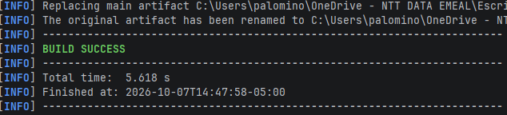
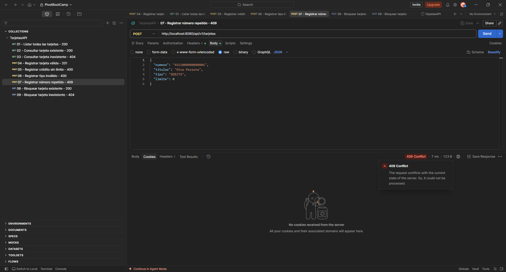
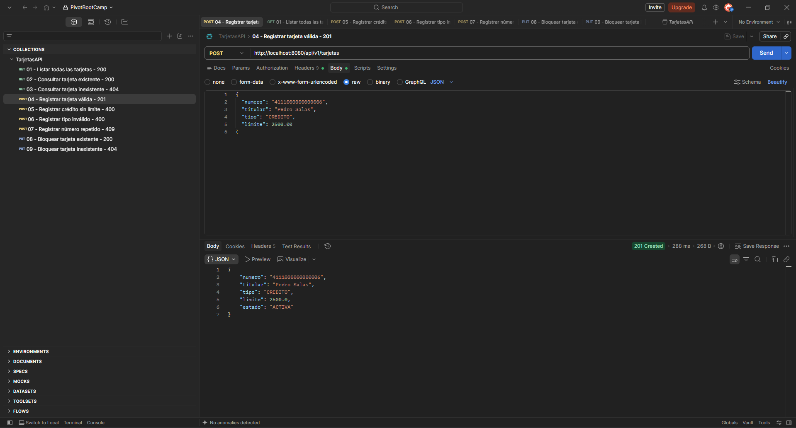

# tarjetas-api

API REST de tarjetas desarrollada para la Sesión 1. El proyecto usa Java 17,
Spring Boot 3.5 y Maven. Los datos se almacenan en memoria, por lo que se
reinician al detener la aplicación.

## Requisitos

- Java 17
- Maven 3.9 o superior

## Compilar

Desde la carpeta `tarjetas-api`, en PowerShell:

```powershell
$env:JAVA_HOME = "C:\Program Files\Java\jdk-17"
mvn clean package
```

El resultado esperado es `BUILD SUCCESS`. El artefacto se genera en
`target/tarjetas-api-1.0.0.jar`.

## Ejecutar

```powershell
$env:JAVA_HOME = "C:\Program Files\Java\jdk-17"
mvn spring-boot:run
```

La API queda disponible en `http://localhost:8080`. También se puede ejecutar
el JAR generado:

```powershell
java -jar target/tarjetas-api-1.0.0.jar
```

## Endpoints implementados

| Método | Ruta | Resultado |
|---|---|---|
| GET | `/api/v1/tarjetas` | Lista todas las tarjetas (`200`) |
| GET | `/api/v1/tarjetas/{numero}` | Consulta una tarjeta (`200` o `404`) |
| POST | `/api/v1/tarjetas` | Registra una tarjeta (`201`) |
| PUT | `/api/v1/tarjetas/{numero}/bloquear` | Bloquea una tarjeta (`200` o `404`) |

El registro valida que el número tenga 16 caracteres, que no esté repetido,
que el titular esté informado, que el tipo sea `CREDITO` o `DEBITO` y que las
tarjetas de crédito tengan un límite mayor que cero. Los datos inválidos
responden `400` y los números repetidos `409`.

## Pruebas manuales

Con la aplicación ejecutándose, se pueden enviar las nueve peticiones de
`requests.http` desde VS Code o importar
[`recursos/TarjetasAPI.postman_collection.json`](recursos/TarjetasAPI.postman_collection.json)
en Postman. Las instrucciones y prompts utilizados durante el ejercicio están
en [`recursos/Promts.md`](recursos/Promts.md). La colección cubre:

- Listado y consulta de tarjetas existentes.
- Respuestas `404` para tarjetas inexistentes.
- Alta válida (`201`).
- Validaciones (`400`) y número repetido (`409`).
- Bloqueo de una tarjeta existente y respuesta `404` si no existe.


## Evidencias

Las evidencias muestran la compilación exitosa, las respuestas de los
endpoints y la ejecución de la API.





## Estructura

```text
tarjetas-api/
├── evidencias/
│   ├── evidencia-01-compilacion.png
│   ├── evidencia-02-pruebas.png
│   └── evidencia-03-ejecucion.png
├── recursos/
│   ├── Promts.md
│   └── TarjetasAPI.postman_collection.json
└── src/main/java/com/nttdata/tarjetas/
    ├── TarjetasApiApplication.java
    ├── controller/TarjetaController.java
    ├── model/Tarjeta.java
    └── repository/TarjetaRepository.java
```

No se incluyen credenciales, tokens ni secretos en el código. La aplicación
utiliza únicamente datos de ejemplo en memoria.
